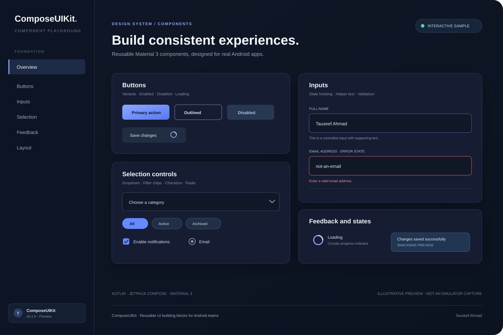

# ComposeUIKit

<p align="center">
  <strong>A reusable Jetpack Compose component library for Android teams.</strong><br/>
  Kotlin · Jetpack Compose · Material 3
</p>

<p align="center">
  <a href="https://github.com/Tauseef-ahmad-dev/ComposeUIKit/actions/workflows/android-ci.yml"></a>
  
  
  
</p>

ComposeUIKit is a small, reusable UI toolkit built on top of Jetpack Compose and Material 3. It provides consistent building blocks for forms, selection controls, feedback, dialogs, and common layouts.

The project is designed for real application teams: APIs are state-hoisted where practical, components expose modifiers and callbacks, and business rules stay in the consuming app.

> **Development status:** APIs are still evolving. The current `0.1.0` scaffold is not yet a stable Maven release. Use it as a source dependency while the public API is refined.

## Component showcase



*Illustrative visual preview of the interactive sample gallery. This is a vector design preview, not a screenshot captured from an Android emulator. Run the sample app for the live components.*

## Highlights

- **Material 3 foundation** — familiar Compose behaviour with a cohesive default theme.
- **State-hoisted APIs** — app state and validation stay in the app.
- **Configurable theme** — override color scheme, typography, shapes, and spacing tokens.
- **Useful input components** — text, password, search, and dropdown fields.
- **Selection controls** — date picker, filter chips, checkbox, and radio group.
- **Feedback and surfaces** — dialogs, modal bottom sheet, loader, snackbar host, empty state, cards, and divider.
- **Interactive sample** — a small app that consumes the library module.
- **Automated checks** — GitHub Actions builds the library, runs unit tests and lint, and builds the sample.

## Components

| Category | Components |
|---|---|
| Theme | `UIKitTheme`, `UIKitColors`, `UIKitTokens` |
| Buttons | `UIKitButton`, `UIKitIconButton` |
| Inputs | `UIKitTextField`, `UIKitPasswordField`, `UIKitSearchField` |
| Selection | `UIKitDropdownField<T>`, `UIKitDatePickerDialog`, `UIKitFilterChip`, `UIKitCheckbox`, `UIKitRadioGroup<T>` |
| Dialogs and sheets | `UIKitDialog`, `UIKitConfirmationDialog`, `UIKitBottomSheet` |
| Feedback | `UIKitLoader`, `UIKitEmptyState`, `UIKitSnackbarHost` |
| Layout | `UIKitCard`, `UIKitDivider` |

## Project structure

```text
ComposeUIKit/
├── composeuikit/                 # Reusable Android library
│   └── src/
│       ├── main/kotlin/dev/tauseef/composeuikit/
│       │   ├── theme/
│       │   └── components/
│       │       ├── buttons/
│       │       ├── inputs/
│       │       ├── selection/
│       │       ├── dialogs/
│       │       ├── sheets/
│       │       ├── feedback/
│       │       └── layout/
│       ├── test/                 # JVM unit tests
│       └── androidTest/          # Library instrumentation tests
├── sample/                       # Interactive consumer app
│   └── src/androidTest/          # Sample UI tests
├── docs/                         # Architecture and API guides
├── gradle/libs.versions.toml
└── .github/workflows/            # CI
```

## Requirements

The project is configured with:

- JDK 17
- Android Gradle Plugin 8.13.2
- Kotlin 2.2.21
- Gradle 8.13
- Android SDK 36
- Minimum Android SDK 26
- Compose BOM 2025.10.01

Use a compatible Android Studio version with Android SDK 36 installed.

## Open and run

1. Clone this repository.
2. Open the repository root in Android Studio.
3. Sync Gradle.
4. Select the `sample` run configuration.
5. Run it on an emulator or Android device.

The CI pipeline provisions Gradle 8.13. If you have a local Gradle installation, the same tasks can be run with:

```bash
gradle :composeuikit:assembleRelease
gradle :composeuikit:test
gradle :composeuikit:lint
gradle :sample:assembleDebug
```

To create the standard Gradle wrapper files locally, run:

```bash
gradle wrapper --gradle-version 8.13
```

Commit the generated wrapper scripts and `gradle/wrapper` directory if you want wrapper-based builds in your clone.

## Use the library in the sample project

The sample consumes the library as a Gradle module dependency:

```kotlin
dependencies {
    implementation(project(":composeuikit"))
}
```

### Text field

```kotlin
var email by rememberSaveable { mutableStateOf("") }

UIKitTheme {
    UIKitTextField(
        value = email,
        onValueChange = { email = it },
        label = "Email address",
        placeholder = "name@example.com",
        helperText = "Use your work email",
        modifier = Modifier.fillMaxWidth()
    )
}
```

### Dropdown

```kotlin
var department by rememberSaveable { mutableStateOf<String?>(null) }

UIKitDropdownField(
    selectedOption = department,
    options = listOf("Design", "Engineering", "Operations"),
    onOptionSelected = { department = it },
    optionLabel = { it },
    label = "Department",
    modifier = Modifier.fillMaxWidth()
)
```

### Button with loading state

```kotlin
UIKitButton(
    text = "Save changes",
    onClick = onSave,
    loading = isSaving,
    enabled = formIsValid
)
```

## Design principles

1. **State belongs to the consumer.** Components accept values and callbacks rather than owning business state.
2. **No app-specific dependencies.** The library must not depend on navigation, repositories, networking, persistence, or Firebase.
3. **Material 3 first.** Use accessible, well-understood Compose primitives instead of custom drawing where it adds no value.
4. **Customisation without complexity.** Expose useful parameters, not every internal implementation detail.
5. **Documented public API.** Public composables should have KDoc and a sample.
6. **Test behaviour.** Validate callbacks, disabled states, validation messages, selection and semantics.

## Documentation

- [Architecture](docs/architecture.md)
- [Component catalogue](docs/components.md)
- [Theming](docs/theming.md)
- [Accessibility and RTL](docs/accessibility.md)
- [Contributing](CONTRIBUTING.md)
- [Changelog](CHANGELOG.md)

## Quality checks

GitHub Actions currently runs:

- Library release compilation
- Library JVM unit tests
- Android lint
- Sample debug compilation

Sample instrumentation tests are included in the repository and can be run on a connected emulator/device with:

```bash
gradle :sample:connectedDebugAndroidTest
```

## Roadmap

- [x] Initial Android library and sample modules
- [x] Material 3 theme and token foundation
- [x] Buttons and text inputs
- [x] Dropdown, date picker, chips, checkbox, and radio group
- [x] Dialog, bottom sheet, feedback, and layout primitives
- [x] Interactive sample playground
- [x] Architecture, theming, component, and accessibility docs
- [ ] Expand component previews and interaction tests
- [ ] Capture real emulator screenshots for README
- [ ] API compatibility checks and release workflow
- [ ] Publish a stable artifact to Maven Central

## License

ComposeUIKit is distributed under the Apache License 2.0. See [LICENSE](LICENSE).
